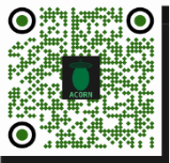

# Papers, models, data and code

One page for everything from the eMMA group's model-assisted electron microscopy work. The ACORN QR code
points at this repository; this page is the index behind it.

## Papers

| Work | Preprint | Journal version | Code and data |
|---|---|---|---|
| **ACORN** platform paper: *Turning Large Electron Microscopy Datasets into Quantitative Measurements with Model-Assisted Analysis* (Williams, Harris) | [Research Square rs-11512593/v1](https://www.researchsquare.com/article/rs-11512593/v1) | submitted | [acorn-measurements-paper](https://github.com/vitrifyai/acorn-measurements-paper) (reproducibility package), data and checkpoint archive [doi:10.13139/ORNLNCCS/3920044](https://doi.org/10.13139/ORNLNCCS/3920044) |
| **TileBac**: *A Benchmark CryoEM Dataset of Bacteria in Ultralow-Dose Montage Tiles* (Massenburg, Madugula, Brown, Bible, Harris, Retterer, Morrell-Falvey, Vasudevan, Williams) | [bioRxiv 10.64898/2026.06.08.731030](https://doi.org/10.64898/2026.06.08.731030), [Research Square rs-11401837/v1](https://www.researchsquare.com/article/rs-11401837/v1) | submitted (Scientific Data) | datasets and models on [Hugging Face, LynnMass](https://huggingface.co/LynnMass); tiles on [GitHub](https://github.com/Lynnicia/TileBac-ultralow-dose-montage-tiles) |
| **Top Model Decision Tree**: *Selecting Segmentation Models for Reliable Quantitative Analysis in Low- and Ultralow-Dose CryoEM* (Massenburg, Madugula, Brown, Bible, Harris, Zhang, Parker, Retterer, Morrell-Falvey, Vasudevan, Williams) | [bioRxiv 10.64898/2026.06.05.730486](https://doi.org/10.64898/2026.06.05.730486) | submitted | models on [Hugging Face, LynnMass](https://huggingface.co/LynnMass) |
| **Bacterial morphology with YOLOv11**: *Automated Bacterial Identification and Morphological Feature Analysis in Low-Dose Cryo-EM Using YOLOv11* (Madugula et al.) | [bioRxiv 10.64898/2025.12.06.692658](https://doi.org/10.64898/2025.12.06.692658) | [Advanced Intelligent Discovery, doi:10.1002/aidi.202500241](https://doi.org/10.1002/aidi.202500241) | [dataset at the ORNL DOE data archive](https://doi.ccs.ornl.gov/dataset/76ab2c53-4e3f-5867-afe2-a34bbd533854) |
| **CryoBlob**: JAX based, JIT compiled feature finding for low SNR cryo-EM images (Mukherjee, Williams, Cox, McDonnell, Borisevich) | software release [doi:10.5281/zenodo.15548974](https://doi.org/10.5281/zenodo.15548974) | SoftwareX, in revision | [debangshu-mukherjee/cryoblob](https://github.com/debangshu-mukherjee/cryoblob), [documentation](https://cryoblob.readthedocs.io) |

Two further ACORN papers (overlap metrics versus size-distribution bias, and SAM 3 prompt vocabulary) are in
preparation and will be added here when posted.

## Models

- **ACORN task models** (YOLO weights trained in ACORN on cryo-TEM nanoparticles and SEM spores): checkpoints and
  hashes in the [ACORN paper archive, doi:10.13139/ORNLNCCS/3920044](https://doi.org/10.13139/ORNLNCCS/3920044);
  configurations in [acorn-measurements-paper](https://github.com/vitrifyai/acorn-measurements-paper).
- **Ultralow-dose bacterial membrane models** (SAM 3, Detectron2, U-Net, YOLOv11 and YOLO26 at 640 and 1024 px):
  [Hugging Face, LynnMass](https://huggingface.co/LynnMass).
- **Foundation models used inside ACORN**: [SAM 3](https://huggingface.co/facebook/sam3) and
  [SAM 2](https://huggingface.co/facebook/sam2) (Meta), fetched by `download_models.py` after accepting their licenses.

## Data

- TileBac: [benchmark dataset](https://huggingface.co/datasets/LynnMass/tilebac-ULDM-benchmark-dataset),
  [montage tiles](https://huggingface.co/datasets/LynnMass/tilebac-ULDM-tiles),
  [stitched montage](https://huggingface.co/datasets/LynnMass/tilebac-stitched-montage),
  [bacteria and flagella](https://huggingface.co/datasets/LynnMass/tilebac-flag-dataset).
- ACORN paper data, annotations and simulation parameters: [acorn-measurements-paper](https://github.com/vitrifyai/acorn-measurements-paper).
- Low-dose bacterial morphology dataset: [ORNL DOE data archive](https://doi.ccs.ornl.gov/dataset/76ab2c53-4e3f-5867-afe2-a34bbd533854).

## Code

- [ACORN](https://github.com/vitrifyai/acorn_software), this repository.
- [acorn-measurements-paper](https://github.com/vitrifyai/acorn-measurements-paper), reproducibility package.
- [cryoblob](https://github.com/vitrifyai/cryoblob) (fork of [debangshu-mukherjee/cryoblob](https://github.com/debangshu-mukherjee/cryoblob)).
- All group repositories: [github.com/vitrifyai](https://github.com/vitrifyai).

## People

Alexis N. Williams ([ORNL profile](https://www.ornl.gov/staff-profile/cv/87811), [Google Scholar](https://scholar.google.com/citations?user=-ZAx8A0AAAAJ)) and Chanda R. Harris,
eMMA group, Center for Nanophase Materials Sciences, Oak Ridge National Laboratory. TileBac work with Lynnicia N. Massenburg and co-authors.
